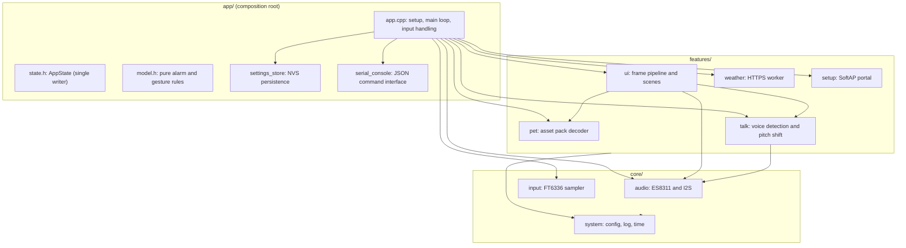
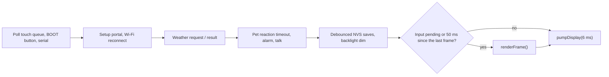
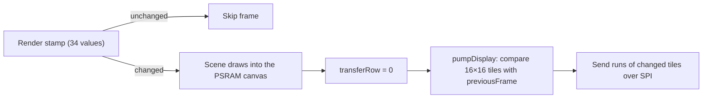
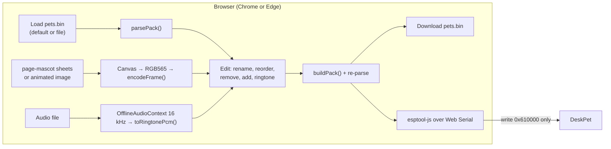
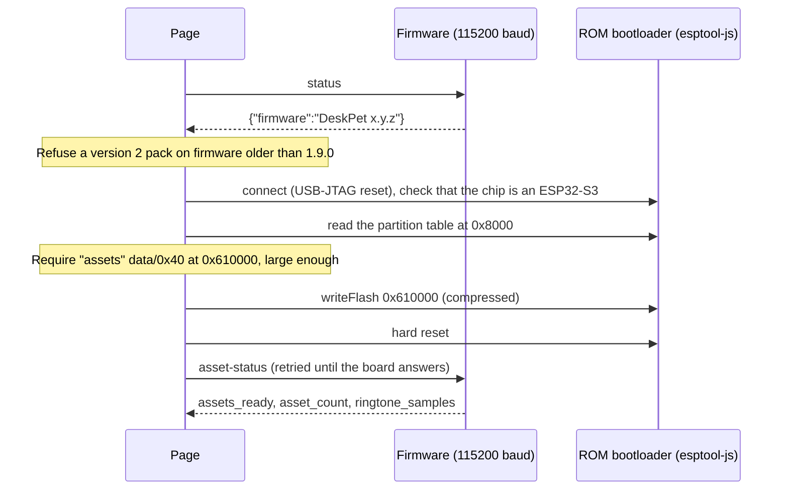

# DeskPet system design

This document describes how DeskPet is built: the firmware on the ESP32-S3,
the asset pack in flash, and the browser customizer that edits and flashes it.
It reflects firmware 1.9.0. For setup and usage, see [README.md](README.md).

## 1. Goals and constraints

| Goal | Consequence in the design |
|---|---|
| Input feels instant on a 20 fps UI | Touch is sampled on its own task; any input forces a redraw on the next loop; the panel is fed in time-boxed slices |
| Network, audio and microphone never stall the UI | Each runs on its own FreeRTOS task on core 0 and talks to the UI through queues or atomics |
| A bad asset pack or failed peripheral never bricks the device | Every external input (pack, NVS, HTTP, form, serial) is validated; the device boots with the failing feature disabled and logs why |
| Pets and the ringtone change without a toolchain | Artwork and the ringtone live in a data partition written by a web page; the firmware stays the same |
| Microphone privacy | Audio is only read while talk mode is on and the pet page is visible, stays in PSRAM, and is overwritten by the next phrase |

Hardware (ES3C28P board):

| Part | Detail |
|---|---|
| SoC | ESP32-S3, 16 MB flash, 8 MB octal PSRAM |
| Display | 2.8" 320×240 ILI9341 over SPI at 40 MHz (DC 46, CS 10, SCK 12, MOSI 11, MISO 13), PWM backlight on GPIO 45 |
| Touch | FT6336 at I2C 0x38 (SDA 16, SCL 15, reset 18) |
| Audio | ES8311 codec at I2C 0x18, full-duplex I2S (MCLK 4, BCLK 5, WS 7, DOUT 8, DIN 6), amplifier mute on GPIO 1 |
| Battery | 3.7 V Li-Po through a 1:2 divider (two 200 kΩ) on ADC1 GPIO 9, sampled every 30 s; the header shows the level as a percentage, with a bolt while charging. Charge state: TP4054 CHRG (open drain, low while charging) on GPIO 21 with the internal pull-up, so an unwired pin reads as not charging. Limit: the TP4054 holds BAT+ near 4.2 V while USB is connected, so the percentage reads near full with or without a pack, and runs above the real level while charging |
| Other | BOOT button (GPIO 0), RGB status LED (GPIO 42) |

## 2. Architecture

The sketch is split into three layers. Dependencies point downwards only.

Rules the code follows:

- **`AppState` has one writer.** Only `app.cpp` mutates it. `ui.cpp` receives
  it as `const AppState &` and only reads it. Workers never touch it; they
  return results through queues.
- **`core/` knows nothing about screens or pets.** The audio module, for
  example, plays whatever buffer it is handed; the app decides that the asset
  pack's ringtone replaces the built-in one (`setRingtone()`).
- **Pure rules live in `model.h`** (alarm due, ring window, swipe direction)
  and are checked at boot by `modelSelfTest()`, reported by the `selftest`
  console command.

## 3. Runtime model

### Tasks

| Task | Core | Priority | Stack | Job | Talks to the loop through |
|---|---|---|---|---|---|
| Arduino `loop` | 1 | 1 | default | Input, state, rendering, panel transfer | — |
| `touch` | 1 | 3 | 3 KB | Reads the FT6336 every 10 ms | Queue of 32 `TouchSample`s (the oldest is dropped when full) |
| `weather` | 0 | 1 | 12 KB | One HTTPS request at a time | Request queue (1) and result queue (1, overwrite) |
| `speaker` | 0 | 1 | 6 KB | Streams PCM to I2S in 256-frame blocks | Request queue (1, overwrite) and atomics |
| `talk` | 0 | 1 | 6 KB | Microphone, voice detection, pitch shift | Atomics (`active`, `phase`, `level`) |

The touch task runs above the loop on the same core, so a long draw cannot
delay sampling. Everything slow (TLS, I2S, DSP) is on core 0.

### Main loop

`appLoop()` runs about every 2 ms:

- Input is drained first, and any input sets `inputPending`, so the next
  frame is drawn on the same pass instead of waiting for the 50 ms tick.
- `perf` and `slow_frame` events (frames or pre-render work over 40 ms)
  record where time goes.
- The loop watchdog is set to 5 s with panic enabled, so a hang reboots the
  board and leaves a core dump in the `coredump` partition.

### Boot sequence

1. Serial, GPIO, the LED off, the amplifier muted.
2. Open NVS and load settings (the backlight then starts at the stored level).
3. Initialise the display; a failure here or in NVS stops the boot with an error screen (`fatalError`).
4. Map and validate the asset pack. If the stored companion index is beyond the pack, reset it to 0.
5. Reset the touch controller, start I2C at 400 kHz, initialise audio and talk, then apply the pack's ringtone if there is one.
6. Start the touch task and the weather worker (a failure in either is fatal).
7. Wi-Fi STA with auto-reconnect, NTP (`pool.ntp.org`, `time.cloudflare.com`, `time.google.com`), timezone `ICT-7`.
8. Configure the watchdog and print `boot`, `selftest` and `status`.

## 4. Rendering pipeline

- **Render stamp.** `renderFrame()` builds an array of every value that can
  change the screen (page, minute, Wi-Fi status, alarm, weather, pet frame,
  talk phase, the slide of the tab highlight, and so on). If it equals the
  previous stamp, nothing is drawn. Changes the stamp cannot see (pet name,
  place) bump `AppState::uiRevision`.
- **Canvas.** Scenes (`scenes/*.cpp`: pet, clock, weather, settings, setup)
  draw a full frame into an `Arduino_Canvas` framebuffer.
- **Tile diff.** `pumpDisplay()` compares each 16×16 tile with
  `previousFrame` (also in PSRAM) and sends only runs of changed tiles,
  a few tile rows per call within a 6 ms budget. A page change therefore
  spreads over several loop passes instead of blocking input.
- **Fonts** are anti-aliased 4-bit glyphs generated into `ui_assets.h`
  (ASCII 32–126 only, which is why names are limited to ASCII).
- Measured on the board: 20–21 fps, worst-case render 14 ms.

## 5. Input

| Gesture | Rule |
|---|---|
| Tap | Release within 25 px of the press |
| Long press (pet only) | Held 650 ms within 15 px on the pet area; opens the companion picker |
| Swipe | Horizontal travel over 55 px and more than twice the vertical travel; changes page (or picker page) |
| Slider drag | A press that starts in a slider's drag zone tracks the finger until release |
| BOOT short press | Next page, or close the setup portal |
| BOOT hold 1.8 s | Open or close the setup portal |
| BOOT while ringing | Stop the alarm |

After 60 s without input the backlight drops to a quarter of the set level
(minimum 3), except on the settings page, during the alarm and in the portal.
The pet falls asleep after 25 s without interaction.

## 6. Features

### Pet

- Companions come from the asset pack (section 9). A **posed** companion has
  18 frames of 144×144: 9 gaze directions (the pet looks towards the finger)
  and 9 expressions. An **animated** companion has up to 2000 frames of 64×64
  that loop on their own timings.
- Taps cycle Love, Sparkle, Surprise, Wink, Bashful and Joy for 1.1 s; four
  taps within 1.6 s of each other make it Dizzy. The tap counter is saved to
  NVS at most every 15 s.
- One decoded frame is cached in PSRAM; frames are scaled with nearest-neighbour sampling.

### Clock and alarm

- Time comes from NTP, or from the phone's clock when the setup form is saved.
- The alarm fires when `hour:minute` match, the clock is valid and today's
  key (`YYYYMMDD`) differs from `lastFiredDay`. That key is written to NVS
  before ringing, so a reboot inside the same minute does not ring again.
- It rings for at most 2 minutes, loops the ringtone and blinks the LED.
  Any tap on Stop or a BOOT press ends it. Alarm checks wait while a settings save is pending.

### Weather

- Open-Meteo over HTTPS (HTTP/1.0, so the body is never chunked), checked
  against the ESP-IDF certificate bundle, so a change of CA needs no reflash.
- Requested 3 s after Wi-Fi connects (DHCP and DNS settle), then every
  15 min, or every 60 s while there is no valid reading. Tapping the page refreshes it.
- DNS uses `lwip_getaddrinfo()`, because `Network.hostByName()` in
  arduino-esp32 3.3 can assert in lwIP while SNTP is resolving.
- The JSON is parsed with an ArduinoJson filter (current temperature,
  humidity, weather code, 6 hours of rain chance) and checked for plausible
  values. Up to 3 attempts with 1 s and 2 s back-off, each logged as a warning.
- Places are a fixed list of six Vietnamese cities in `config.h`.

### Talk mode

- 16 kHz microphone blocks of 20 ms, high-passed at 100 Hz (second order) so
  wind rumble neither starts a phrase nor gets repeated. The noise floor adapts;
  a phrase starts after 60 ms above it and ends after 1.2 s of quiet. 250 ms of
  pre-roll is kept so the first syllable is not lost.
- Phrases shorter than 12 voiced blocks (claps, desk bumps) are ignored, as
  is anything within 400 ms after playback (the speaker's own echo).
- Pitch shift: Hann-windowed grains of 1024 samples every 512 samples, each
  read 1.6 times faster, so the pitch rises without changing the length.
  Quiet phrases are lifted towards the alarm's average loudness (RMS 3000), at
  most ×16. Loud phrases keep the older gain (peak 20000, at most ×8), so none gets
  quieter. No sample passes 22000, the alarm's own peak. Phrases are capped at 6 s.
- Buffers (recording, voice, mix) are allocated once in PSRAM.

### Setup portal

- SoftAP `DeskPet-XXXX` (from the eFuse MAC) with a random 12-character
  password from an unambiguous alphabet, unless one was set with the
  `ap-password` console command. It is shown on screen while the portal is open.
- `GET /` serves the form, `GET /scan` lists networks (async scan, deduplicated, the 30 strongest),
  `POST /save` applies it. Requests from outside `192.168.4.x` are refused, and
  the form carries a per-session random token.
- Validation: SSID ≤ 32 bytes, password empty or 8–63 characters, pet name
  1–12 alphanumerics or spaces, place index, brightness 3–255, phone epoch
  between 2024 and 2099. The form is saved to NVS before it is applied.
- The portal offers itself once, 18 s after boot, if Wi-Fi was never reached and nobody is using the device.

## 7. Audio

- ES8311 configured for 16 kHz with MCLK at 256×; one full-duplex I2S port
  serves both the speaker and the microphone. Register writes retry 3 times,
  and a DAC register is read back to confirm the codec answered.
- Each request carries a generation number. A newer request, a cancel or a
  volume of 0 makes the playing one stale, so it stops within one 256-frame block (16 ms).
- Before the amplifier is unmuted, 100 ms of silence primes the DMA buffer to avoid a pop.
- Volume is applied as the square of the 0–100 setting.
- The ringtone is the pack's ringtone when the pack has one (section 9),
  otherwise the PCM compiled in from `ringtone_data.h` (`tools/build_ringtone.py`).

## 8. Persistence (NVS namespace `deskpet`)

| Key | Type | Written when |
|---|---|---|
| `bright`, `volume`, `muted`, `talk` | u8 / bool | 600 ms after the last change (debounced), together with the alarm keys |
| `alarm_hour`, `alarm_min`, `alarm_on` | u8 / bool | Same debounced save |
| `alarm_day` | u32 | Debounced save, and immediately when the alarm fires |
| `mascot` | u8 | When a companion is picked |
| `pets` | u32 | Tap counter, at most every 15 s |
| `pet`, `place` | string / u8 | When the setup form is saved |
| `ssid`, `password` | string | When the setup form names a network (an empty password removes the key) |
| `ap_password` | string | `ap-password` console command |

A failed write is logged and retried on the next pass; it is never ignored.

## 9. Flash layout and asset pack

### Partitions (`deskpet/partitions.csv`)

| Name | Type | Offset | Size | Use |
|---|---|---|---|---|
| `nvs` | data/nvs | `0x9000` | 20 KB | Settings |
| `otadata` | data/ota | `0xE000` | 8 KB | OTA slot selection |
| `app0` | app/ota_0 | `0x10000` | 3 MB | Firmware (about 1.4 MB) |
| `app1` | app/ota_1 | `0x310000` | 3 MB | Reserved for OTA |
| `assets` | data/0x40 | `0x610000` | 9.875 MB | Asset pack (`pets.bin`) |
| `coredump` | data/coredump | `0xFF0000` | 64 KB | Panic dumps |

### Pack format (`DPETAS01`)

All integers are little-endian. The partition is memory-mapped, so frames and
the ringtone are read straight from flash without copying.

| Offset | Size | Field |
|---|---|---|
| 0 | 8 | Magic `DPETAS01` |
| 8 | 4 | Version: 1, or 2 when a ringtone is present |
| 12 | 4 | Total pack size in bytes |
| 16 | 4 | CRC-32 (zlib) of bytes 24 to the end |
| 20 | 4 | Companion count (3–16) |
| 24 | 8 | **Version 2 only:** ringtone offset, sample count (both 0 for none) |
| 24 or 32 | 40 × count | Directory entries |

Directory entry (40 bytes): name (24 bytes, NUL-terminated ASCII), kind (u16:
0 posed, 1 animated), side (u16: 144 or 64), frame count (u32), frame table
offset (u32), duration in ms (u32: 0 for posed, 1–120000 for animated).

Frame record (12 bytes): data offset, data length, end time in ms (0 for posed;
strictly increasing for animated, the last one equal to the duration).

After the tables come the frame data, then (version 2) the ringtone as
16 kHz mono `int16` on a 4-byte boundary (at most 30 s), then an attribution
trailer with the page-mascot licence.

**Frame encoding.** The first byte selects the encoding: 0 means raw RGB565
samples, 1 means a palette of up to 256 RGB565 colours (a u16 count, then the
colours) followed by 8-bit indices. The samples are then run-length coded: a
u16 tag with the top bit set is a run (the count in the low 15 bits, then one
sample); otherwise the tag is a count of literal samples that follow. The
encoder keeps whichever of the two encodings is smaller.

**Validation at boot** (`initPetAssets()`): magic, version, size within the
partition, count, CRC over the whole pack, ringtone bounds and alignment,
each entry's kind/side/frame count/duration, every frame record's bounds and
timing. Frame decoding checks palette indices and run bounds and requires
exactly `side²` pixels. Any failure disables the pets and the pack ringtone,
logs a `pet_assets` error, and the device still boots.

**Compatibility.** Firmware before 1.9.0 accepts only version 1, so a pack
without a ringtone is always written as version 1.

## 10. Browser customizer (`web/`)

A static page with no build step: `index.html`, `app.js` (UI and flashing)
and `pack.js` (pure pack logic, also used by the Node tests).

- **Parity with the Python tool.** `pack.js` writes the same layout and
  encoding as `tools/build_pet_assets.py`, and `parsePack()` repeats every
  firmware check. `node --test web/` re-encodes every shipped frame and
  rebuilds `deskpet/assets/pets.bin` byte for byte.
- **New companions.** Two 3×3 sheets (same format as the
  [page-mascot gallery](https://koboyo.com/page-mascot), 1080×1080): the
  union of opaque pixels (alpha over 24) across all 18 cells sets one square
  crop with a margin, scaled to 144 px and composited over black. Both files
  can be picked at once; they are sorted by their `-directions` and `-reactions`
  suffixes, and the name is taken from the file name. Animated GIF, WebP or
  APNG files are decoded with `ImageDecoder` and fitted into 64×64.
- **Ringtone.** Decoded by the browser, trimmed to at most 30 s, resampled to
  16 kHz mono, with 8 ms fades at both ends so the loop does not click (as `build_ringtone.py` does).

Flash sequence:

NVS is never written, so Wi-Fi, the alarm and other settings survive.

## 11. Observability and QA

- **Serial console** (115200 baud, one command per line, JSON replies):
  `status`, `perf`, `ui-stats`, `settings-status`, `alarm-status`,
  `pet-status`, `asset-status`, `talk-status`, `selftest`, `asset-selftest`,
  `sound-test`, `mic-test`, `talk-tune`, `page`, `tap`, `hold`, `pet`,
  `setup`, `snapshot`, `ap-password`, `reboot`.
- **Events and errors** are JSON lines (`{"event":...}`,
  `{"level":"error","component":...,"reason":...}`) so scripts can parse them.
- **Host tools** (`deskpet/tools/`): `verify_pet_assets.py` drives the UI and
  saves framebuffer snapshots to `qa/snapshots/`; `perf_probe.py` and
  `jank_monitor.py` measure responsiveness; `boot_logger.py` records resets
  and panics; `talk_monitor.py` follows talk mode live.
- **Self-tests**: `modelSelfTest()` (alarm and gesture rules) at boot;
  `asset-selftest` decodes every frame and prints a CRC to compare with
  `decoded_crc32` in `assets/manifest.json`.

## 12. Security and privacy

| Area | Measure | Known gap |
|---|---|---|
| Setup portal | WPA2 SoftAP with a random password, subnet check, per-session form token, strict field validation, HTML escaping of SSIDs and names | HTTP only, on the portal's own network |
| Credentials | Never logged; the setup screen is never dumped by `snapshot` | Wi-Fi password is stored in NVS without NVS encryption |
| Weather | TLS verified against the certificate bundle | — |
| Microphone | Read only while talk mode is on and the pet page is visible; audio stays in PSRAM and is never stored or sent | — |
| Asset pack | Fully bounds-checked before use, so a crafted pack cannot read outside the partition | Not signed: anyone with USB access can flash a pack |

## 13. Build and release

- `arduino-cli` profile `es3c28p` in `deskpet/sketch.yaml` pins the ESP32 core (3.3.12),
  GFX Library for Arduino (1.6.9) and ArduinoJson (7.4.3).
  FQBN options: USB mode `hwcdc`, CDC on boot, 16 MB flash, OPI PSRAM, custom partitions.
- The version is the single `DESKPET_VERSION_NUMBER` in `config.h`, shown on the
  boot splash, the settings page and in `status`.
- Releases ship `deskpet-vX.Y.Z-full.bin` (at `0x0`: bootloader, partitions,
  app and pets; resets NVS) and `deskpet-vX.Y.Z-app.bin` (at `0x10000`).

## 14. Limitations and next steps

- **OTA is not implemented** although the partition table keeps a second app
  slot; updates go over USB.
- Timezone (`ICT-7`) and weather places are fixed at compile time.
- One alarm, no snooze, no weekday schedule.
- NVS is not encrypted, and asset packs are not signed.
- The web flasher needs a browser with Web Serial (Chrome or Edge on a desktop).
